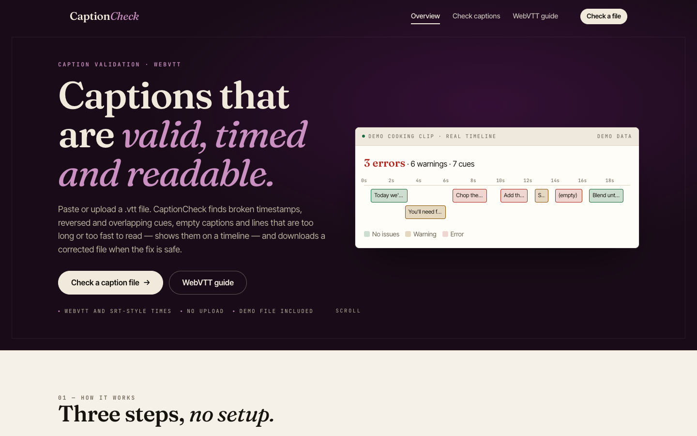
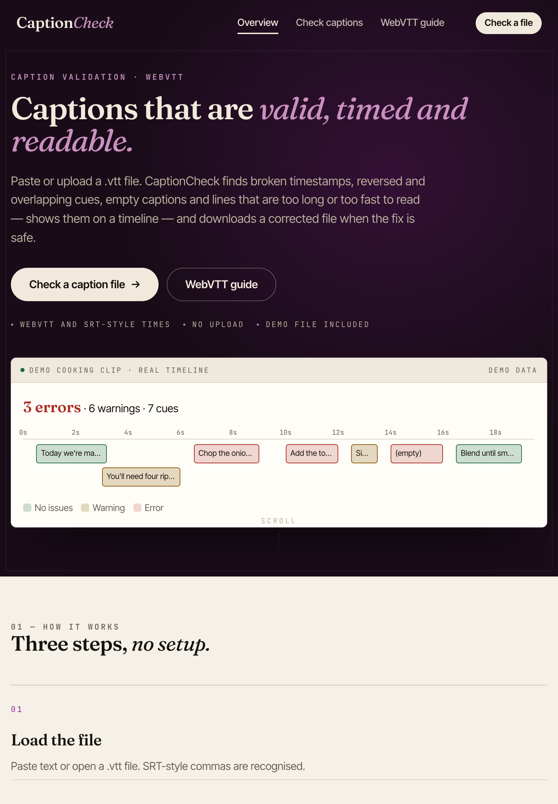
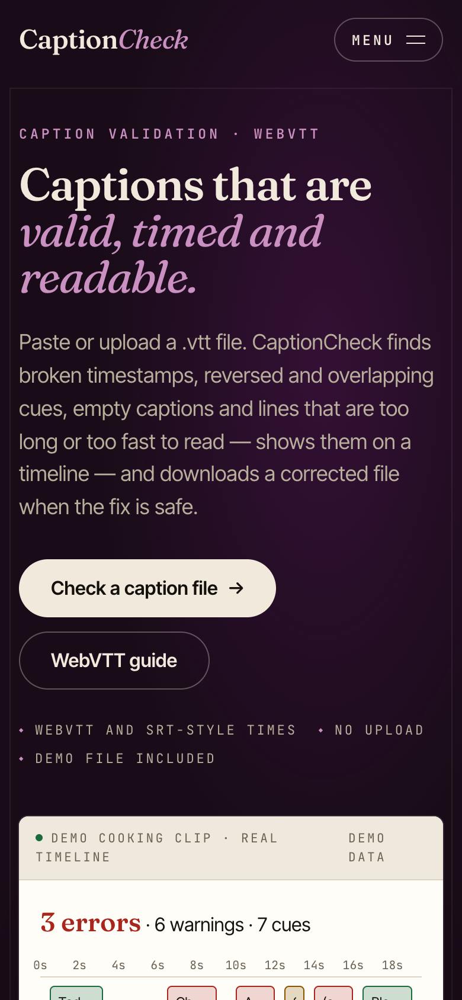
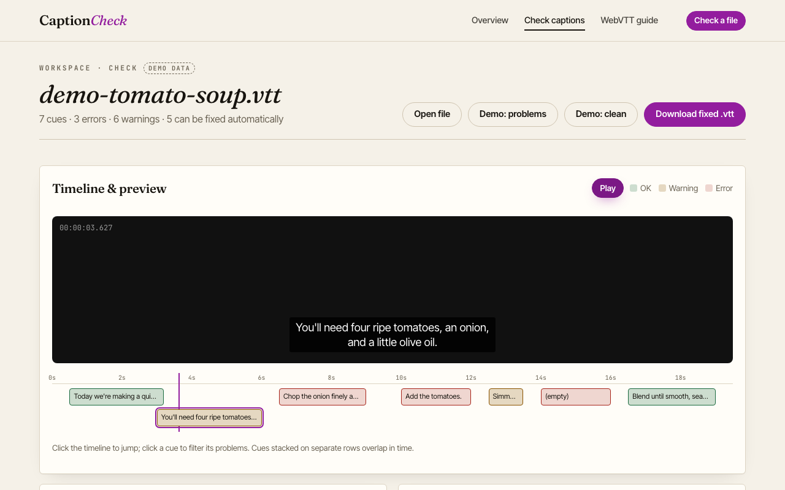
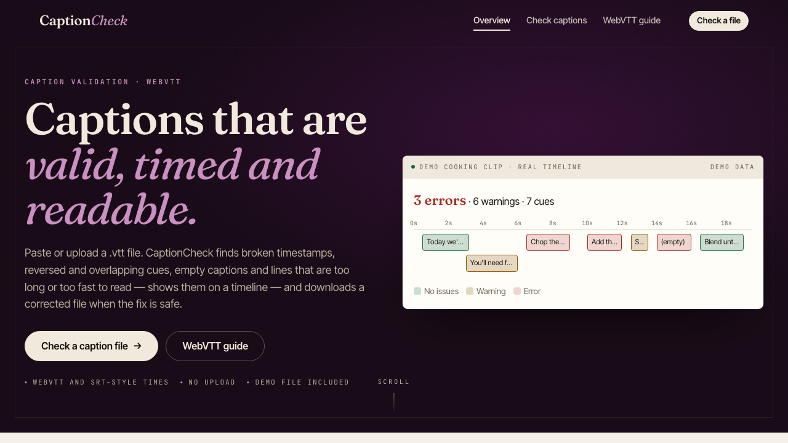
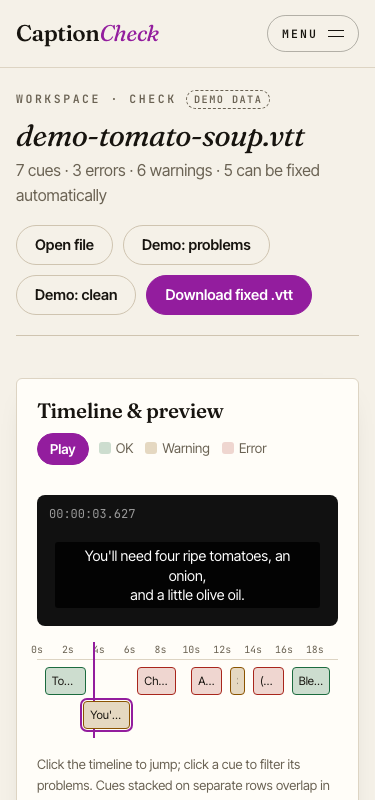

# CaptionCheck

<!-- screenshots:start -->
<p align="center">
  
</p>
<p align="center">
  
  &nbsp;&nbsp;
  
</p>
<p align="center"><sub>Mac (1440×900) · Tablet (820×1180) · Phone (390×844)</sub></p>
<!-- screenshots:end -->

Validate WebVTT caption files: find invalid and reversed timestamps, overlaps, out-of-order and empty cues, and readability problems; see every cue on a timeline with a playback preview; and download a corrected file when the fix is safe.

**Live demo:** [https://kavishtolani.github.io/captioncheck/](https://kavishtolani.github.io/captioncheck/) — runs entirely in your browser; demo data is fictional and labelled.



| Landing | Mobile |
| --- | --- |
|  |  |

## Run it

```bash
npm install
npm run dev        # http://localhost:5127
npm test
npm run build
npm run test:e2e   # Playwright smoke test (npm run e2e:install once if Chromium is missing)
```

## Main workflow

1. **Check captions** opens with a labelled demo file for a fictional cooking clip that contains an overlap, SubRip-style commas, a reversed cue, a duplicate id, an empty cue, a long fast line and a NOTE block. **Demo: clean** loads a valid file; clearing the text shows the empty state.
2. Paste or **Open file** (.vtt/.srt/.txt up to 2 MB).
3. **Timeline & preview** — each cue is a bar coloured by severity; overlapping cues stack on separate rows. Click to seek or select a cue; **Play** shows captions in a dark preview frame, with a warning when more than one is on screen.
4. **Problems** — line number, cue, message and whether it's auto-fixable; filter by severity or by the selected cue.
5. **Corrected** shows the change log and the corrected file; **Download fixed .vtt** saves it. Issues that need a human (unreadable timing, long or fast lines) are reported, not silently changed.

## Automatic fixes

Add the `WEBVTT` header · commas → full stops · swap reversed start/end · remove empty and zero-length cues · sort by start time · trim the earlier of two overlapping cues · rename duplicate ids. NOTE/STYLE/REGION blocks are preserved.

## Tests

- `src/lib/vtt.test.ts` — timestamp parsing (with/without hours, commas, invalid), clean file, every problem type, NOTE blocks, active cues, fixing to an error-free file with change log and unrepairable cues reported.
- `src/App.test.tsx` — demo problems and cue filter, corrected output re-validated, clean file, upload, empty state.
- `e2e/smoke.spec.ts` — select a cue and see it in the preview, play/pause, download and inspect the fixed file; strict 375px checks.

## Limitations

- No video/audio: the preview shows captions over a blank frame, so it can't check sync against speech.
- Cue settings (position, line, align) are kept but not validated or rendered.
- SRT files are not converted in full (cue numbers become ids).

## Future improvements

- Load a local video for real sync preview; full SRT ↔ VTT conversion; validate cue settings.

## Licence

MIT — see [LICENSE](LICENSE).
